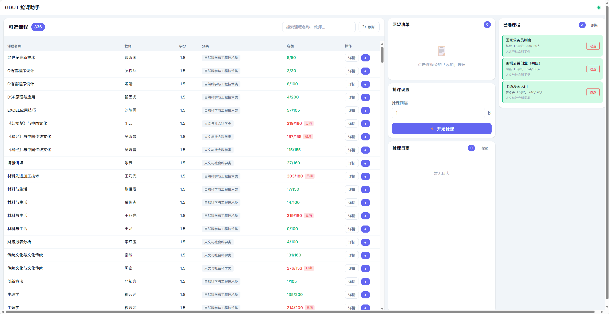
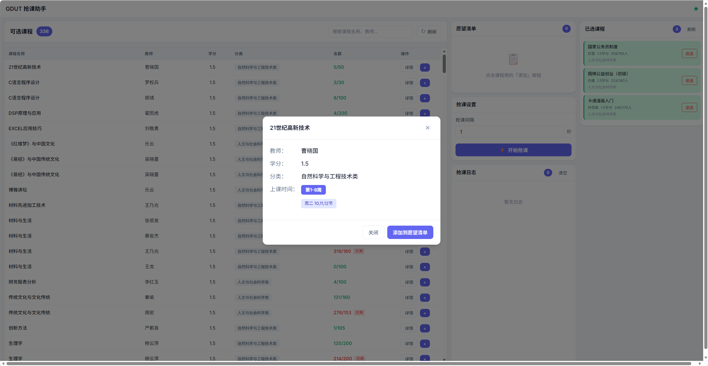

# GDUT 抢课助手

广东工业大学教务系统自动抢课工具（桌面版），支持课程浏览、收藏、并发抢课、系统托盘后台运行。

基于 [mygo](https://github.com/egoist/mygo) 构建：Go 后端通过类型化 IPC 直接驱动 WebView2 前端，单文件分发，无浏览器依赖。

## 功能特性

- JSESSIONID 登录（从浏览器复制）
- 课程列表浏览，支持搜索和分类筛选
- 课程详情查看（上课时间、周次、余量）
- 愿望清单（拖拽排序，持久化保存，自动校验限选门数）
- 并发抢课（最多 5 个 goroutine），可调抢课间隔
- 已选课程管理（退选，两步确认）
- 实时抢课日志（事件推送，无需轮询）
- **关窗最小化到托盘，抢课成功弹系统通知**
- 单实例运行，明暗主题跟随系统

## 界面预览

| |
|:---:|
|  |
|  |

（截图为 v1 web 版界面，v2 桌面版界面已重新设计）

## 快速开始

### 方式一：直接下载（推荐）

从 [Releases](https://github.com/KirishimaRin/GDUT_Course_Helper/releases) 下载对应平台的最新版本：

- `GDUT Course Helper Setup x.y.z amd64.exe` - Windows 安装包
- `GDUT Course Helper.exe` - Windows 便携版
- Linux / macOS 同目录下有对应产物（deb / app+dmg）

双击运行即可，无需安装浏览器或其他依赖（Windows 10 需 WebView2 Runtime，Windows 11 内置）。

### 方式二：源码运行

#### 环境要求

- Go 1.27.3+（首次构建自动下载对应 toolchain）
- [Bun](https://bun.sh) 1.1+
- Windows 10+ / macOS 12+ / Linux（WebKitGTK 4.1）

```bash
git clone https://github.com/KirishimaRin/GDUT_Course_Helper.git
cd GDUT_Course_Helper
bun install

make run     # 开发模式：Vite 热更新 + Go 热重启
make build   # 构建当前平台，产物在 build/<os>-<arch>/
make build-all  # 交叉编译全平台（无 cgo，任意机器可出全平台）
```

## 使用说明

1. 打开广东工业大学教务系统 <https://jxfw.gdut.edu.cn>，登录后按 F12 打开开发者工具
2. 在 应用/Network 面板找到 Cookie 中的 `JSESSIONID` 值并复制
3. 启动本应用，粘贴 JSESSIONID 导入
4. 浏览课程，点击分类标签筛选，输入关键词搜索
5. 将想抢的课程点 ★ 或「抢」加入愿望清单（左栏可拖拽排序）
6. 点击「开始抢课」，应用自动并发抢课
7. 关闭窗口应用仍在托盘运行，抢到课会弹系统通知

## 项目结构

```
GDUT_Course_Helper/
├── .github/workflows/      # GitHub Actions 多平台发布
├── main.go                 # mygo 应用入口（窗口/托盘/通知）
├── internal/
│   ├── auth/               # JSESSIONID 认证
│   ├── grabber/            # 抢课核心逻辑（并发、结果回调）
│   └── service/            # IPC service 层（handler 的替代）
├── src/                    # 前端（Vite + TypeScript）
│   ├── mygo.ts             # 自动生成的类型化 IPC client
│   ├── main.ts             # 入口：登录路由 + 事件订阅
│   ├── app.ts              # 主视图
│   └── style.css           # 设计 token + 组件
├── mygo.config.ts          # mygo 应用配置
└── Makefile
```

## 抢课逻辑

- 并发数：最多 5 个 goroutine 同时抢课
- 课程已满：自动跳过，继续尝试
- 时间冲突：自动移除该课程
- 超出限选：自动移除该课程
- 已选课程：自动移除
- 全部处理完自动停止并通知

## 开发命令

```bash
make run          # 开发模式
make build        # 构建当前平台
make build-all    # 交叉编译所有平台
make clean        # 清理构建产物
bun x tsc --noEmit   # 前端类型检查
```

## 测试环境

- **系统**：Windows 11（Build 26300）
- **架构**：AMD64

其他平台（Linux / macOS）未做完整测试，可能存在兼容性问题。

## 免责声明

本工具**仅供学习参考**，请在下载后 **24 小时内删除**。

使用者需自行承担以下责任：

1. **合规性**：请遵守广东工业大学教务系统相关管理规定及国家法律法规
2. **使用风险**：因使用本工具导致的账号封禁、成绩作废等后果由使用者自行承担
3. **禁止商用**：严禁将本工具用于任何商业目的或收费服务
4. **责任限制**：作者不对因使用本工具产生的任何直接或间接损失承担责任

如您不同意上述条款，请立即停止使用并删除本工具。
